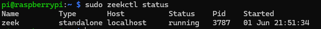
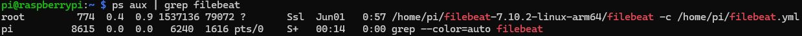
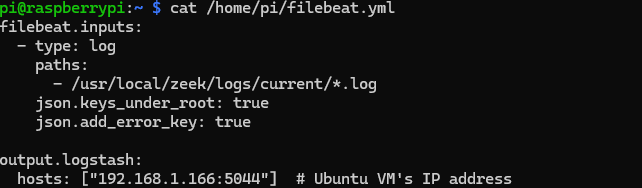
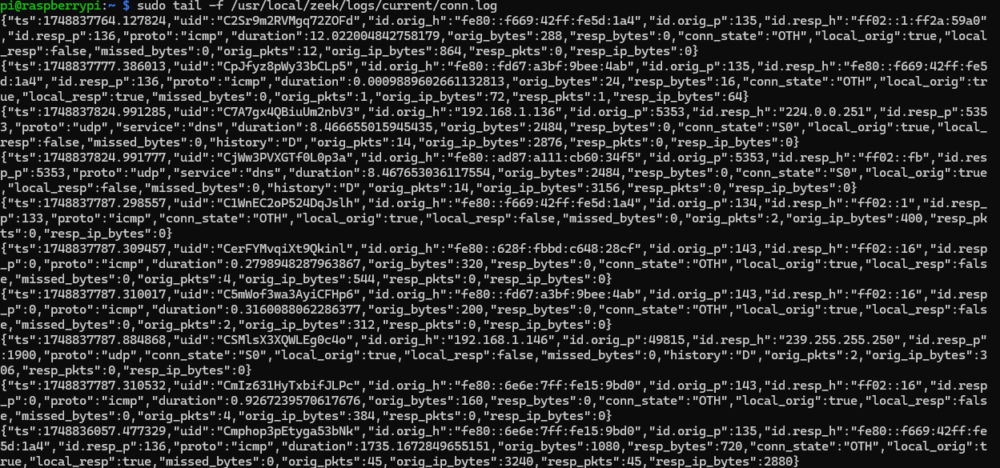
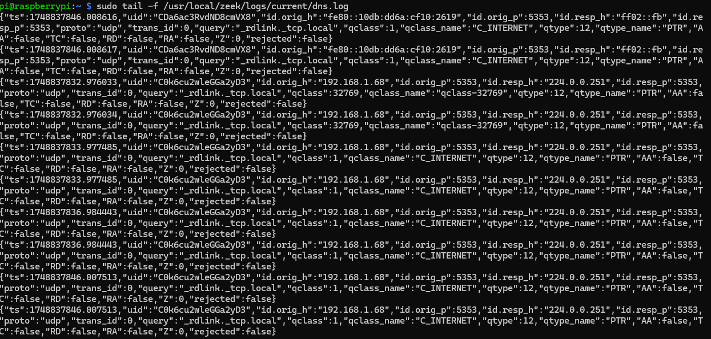

##Raspberry Pi setup

This node runs Zeek which is used to monitor the mirrored traffic we obtain from our Victim Vm through the use of a NIC that is connected to a NetGear switch that is mirroring the traffic to the Raspberry Pi

### Services in Use 
-Zeek 6.0.4

-Filebeat OSS.7.10.2

```

               ┌────────────┐
               │  Internet  │
               └────┬───────┘
                    │
              ┌─────▼──────┐
              │ Netgear SW │
              └────┬───────┘
         Mirror    │
         Port      │
        ▼          ▼
┌──────────────┐ ┌──────────────┐
│ Raspberry Pi │ │  Victim VM   │
│ (Zeek, FB)   │ │ (Logs Gen.)  │
└──────┬───────┘ └──────────────┘
       │
       ▼
┌──────────────────────┐
│   Ubuntu VM (SOC)    │
│ ┌──────────────────┐ │
│ │ Logstash + Kibana│ │
│ └──────────────────┘ │
│ ┌──────────────────┐ │
│ │  Elasticsearch   │ │
│ └──────────────────┘ │
└──────────────────────┘
```

### Run Commands
### Zeek Running

### Filebeat Running

### Filebeat Configuration File

### Zeek Logs
### Zeek Conn log Output

### Zeek DNS log Output

### Zeek SSH Log Output


