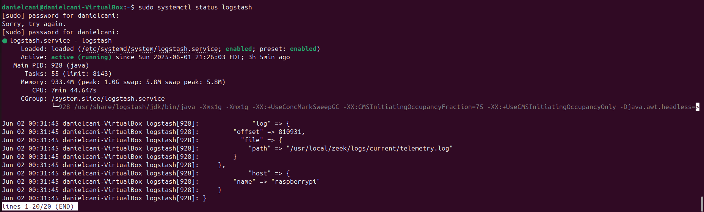
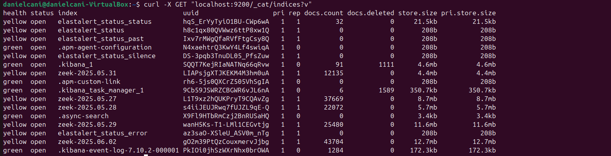
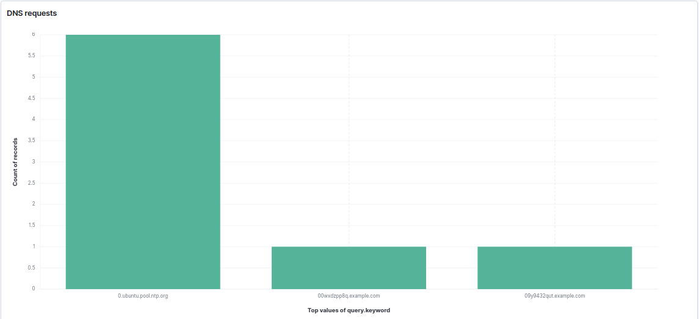
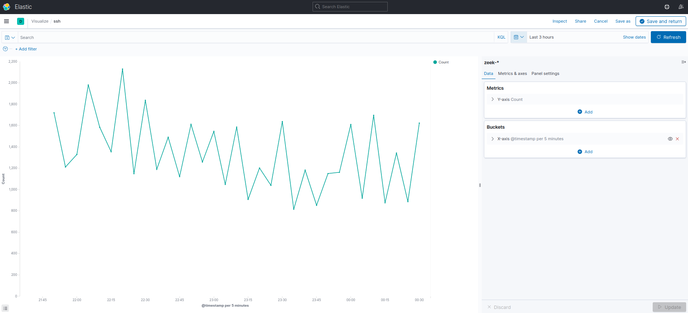
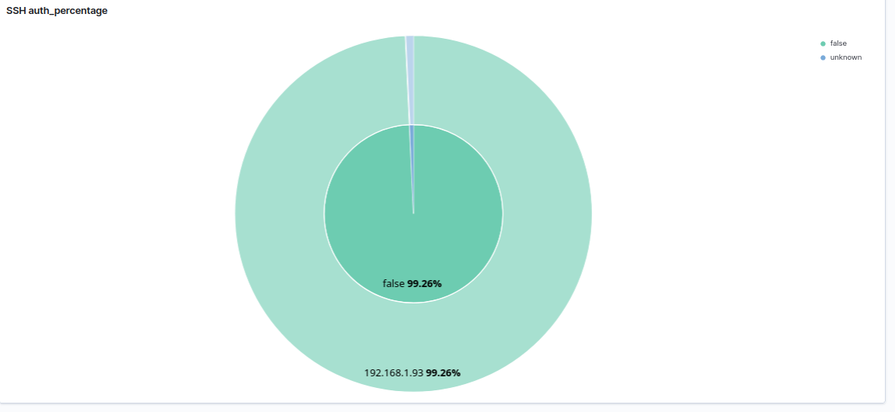
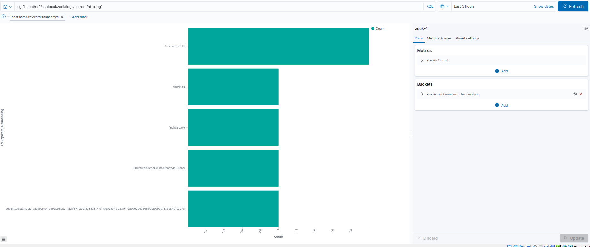
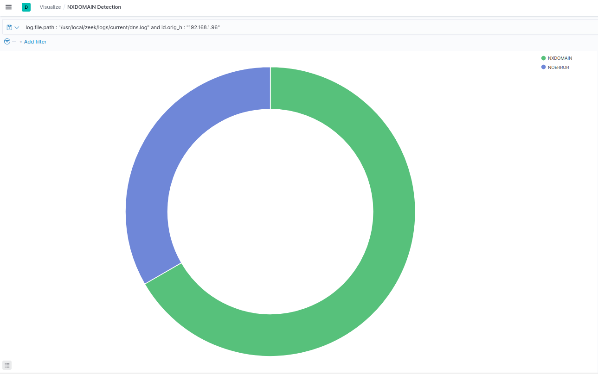

### Ubuntu VM (SOC) Setup'

This nodes serves as the SOC, aggregating and analyzing log data that is coming from the Raspberry Pi monitoring node. It gets the zeek logs via Filebeat and then uses Logstash on the SOC VM to parse, transform and route data into Elasticsearch which is then visualized with Kibana

### Services in use
ELK-

ElasticSearch

Logstash 

Kibana

### Architecture 
              +-------------------+
              |    Raspberry Pi   |
              |  (Zeek + Filebeat)|
              +---------+---------+
                        |
                        | JSON logs over Beats (5044)
                        v
              +---------+---------+
              |      Logstash     |
              +---------+---------+
                        |
                        v
              +---------+---------+
              |   Elasticsearch   |
              +---------+---------+
                        |
                        v
              +---------+---------+
              |      Kibana       |
              +-------------------+

### Visuals 
Logstash status

Elasticsearch status

DNS Logs Visualization

SSH Attempts

SSH Authentication Attemps

HTTP requests

NXDomain Detection

